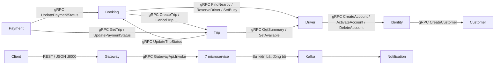

# Giao tiếp nội bộ bằng gRPC



REST chỉ là giao diện của client với Gateway. Gateway gọi `GatewayApi.Invoke`
qua gRPC để chuyển method, path, JSON body và header tới service. Adapter gọi
middleware/controller Express trong cùng tiến trình, không dùng HTTP loopback.
Các lời gọi nghiệp vụ giữa service dùng các unary RPC có tên và request protobuf
riêng trong [cab.proto](cab.proto). Response `Result` giữ status nghiệp vụ và JSON
body hiện có để giữ nguyên response REST cho client.

| Service | Cổng gRPC trong Docker |
|---|---:|
| identity-service | 50050 |
| customer-service | 50051 |
| driver-service | 50052 |
| booking-service | 50053 |
| trip-service | 50054 |
| payment-service | 50055 |
| notification-service | 50056 |

Các cổng này không publish ra host. Service nghiệp vụ không mở HTTP listener.
Gateway là HTTP listener duy nhất cho API nghiệp vụ, publish `8000:8000`.
Health của từng service cũng được Gateway gọi qua gRPC; client kiểm tra bằng
`GET http://localhost:8000/health/services`.

Mỗi lời gọi mang metadata `x-service-token` (JWT nội bộ với `iss`, `aud`, hạn dùng)
và `x-request-id`. Server kiểm tra token và allowlist theo RPC trong
`shared/src/grpc/contracts.js`. `GatewayApi.Invoke` chỉ chấp nhận issuer `gateway`.
`CancelTrip` còn yêu cầu JWT người dùng, kiểm tra vai trò và quyền sở hữu chuyến.
Thiếu/sai token trả gRPC `UNAUTHENTICATED`; sai caller trả `PERMISSION_DENIED`.
Lỗi nghiệp vụ giữ nguyên status/body trong `Result`.

Client dùng deadline mặc định 5 giây, health 2 giây. Có thể cấu hình địa chỉ bằng
`IDENTITY_SERVICE_GRPC_ADDRESS`, `CUSTOMER_SERVICE_GRPC_ADDRESS`,
`DRIVER_SERVICE_GRPC_ADDRESS`, `BOOKING_SERVICE_GRPC_ADDRESS`,
`TRIP_SERVICE_GRPC_ADDRESS`, `PAYMENT_SERVICE_GRPC_ADDRESS`,
`NOTIFICATION_SERVICE_GRPC_ADDRESS`; ví dụ `localhost:50052` khi chạy local.
Mặc định dùng tên service Docker và cổng trong bảng. `GRPC_PORT` đổi cổng listen.
Transport hiện dùng HTTP/2 không TLS trong mạng Docker, kèm JWT nội bộ.

Kafka vẫn xử lý sự kiện bất đồng bộ. Adapter tới nhà cung cấp bên ngoài có thể
dùng REST; callback của nhà cung cấp đi qua Gateway.

Từ thư mục `backend`, chạy:

```sh
npm install
npm test
docker compose up -d --build
```

`npm test` kiểm tra truyền dữ liệu qua tất cả RPC nghiệp vụ, xác thực/caller,
deadline/cancel, adapter public và REST → Gateway → gRPC bằng server thật và
handler giả lập. Kiểm thử này không cần database. Smoke test nghiệp vụ đầy đủ
cần PostgreSQL, Redis, MongoDB và Kafka của dự án.

Tham khảo: [gRPC Node basics](https://grpc.io/docs/languages/node/basics/).
